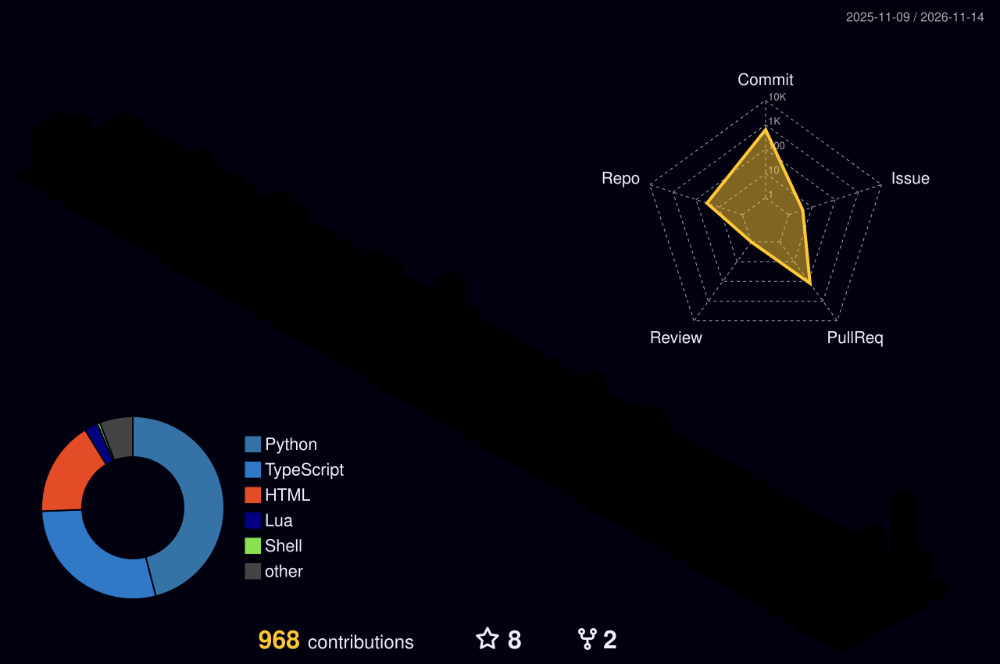

<h1>Hey, I'm Alexander(Lex) 👋</h1>

  

 
 

Solo founder of **Lexmakesit**. I build production software for real clients and run it on cloud servers and my own self-hosted infrastructure.

The proof is in daily use: a point of sale system a working bakery runs on every day, a reseller app backed by more than 1,000 automated tests, and client projects shipped end to end, from first call to production.

Underneath that, I am a Computer Science student at PCCC in Paterson, NJ, finishing my AS (expected Fall 2027). I am a first-generation college student, and I found my first clients by cold-calling local businesses. I still build like it: real users, real software, no demos.  
- Right now I am building StudyHelp and Vendora, and shipping client work through Lexmakesit  
- Outside tech: guitar, football, and Marvel Rivals  
- Fastest ways to reach me are LinkedIn and the email in the footer below

### Are you an employer?
> [!IMPORTANT]
> I am looking for full-time roles and internships where I can ship real products. I work remote or within a commute of Paterson, NJ. If your team ships to real users, I want to talk. The fastest ways to reach me are [LinkedIn](https://www.linkedin.com/in/alexander-santiago-26a170292), [lexmakesit.com](https://lexmakesit.com), and the email in the footer below.

  

### Featured projects

**🚀 Currently Working On: Vendora**

  
  <h3><a href="https://vendora.lexmakesit.com">Vendora, reseller operations app</a></h3>
  

    <strong>Vendora</strong> is the operations app I am building for resellers, covering inventory, sales, and POS workflows in one place. It integrates Stripe payments plus eBay and StockX, and the backend runs at 95.8% test coverage with more than 1,000 tests.
  

  

    Built with <strong>React Native</strong>, <strong>FastAPI</strong>, <strong>PostgreSQL</strong>, and <strong>Docker</strong>.
  

  

    <a href="https://vendora.lexmakesit.com"><strong>Try it Live</strong></a> &nbsp;|&nbsp;
    <a href="https://github.com/as4584/Vendora"><strong>💻 View Source</strong></a>
  

  

    
  

 

  

**My favorite completed project: BakeryPOS**

  
  <h3><a href="https://github.com/as4584/BakeryPOS-release">BakeryPOS</a></h3>
  

    A point of sale system I built solo for La Jarochita Bakery in Passaic, NJ. It is in daily use at the bakery. Production updates ship through the public release channel linked below, while the source stays private because it is client work.
  

  

    Built with <strong>.NET 8</strong>, <strong>WPF</strong>, and <strong>SQLite</strong>.
  

  

    <a href="https://github.com/as4584/BakeryPOS-release"><strong>Release Channel</strong></a>
  

 

**Also pinned**

- **[StudyHelp](https://github.com/as4584/StudyHelp)**: tutoring marketplace. Students get instant AI study help and escalate to vetted human tutors, with chat auto-translated between them. Built with Next.js, FastAPI, and Supabase.
- **[Lexmakesit](https://github.com/as4584/lexmakesit)**: my studio workspace, home of the AI receptionist platform, my portfolio site, and the tooling behind my client projects. Built with Python and FastAPI.
- **[Agentops](https://github.com/as4584/Agentops)**: local-first multi-agent AI platform, a control center for running and observing AI agents on my own hardware. Its README documents 1,165+ tests. Built with FastAPI, LangGraph, and Next.js.
- **[Neon District Autopilot](https://github.com/as4584/neon-district-autopilot)**: documented automation case study running a music publishing channel with guarded local AI model trials. Built with Python.

**Tech Stack**

Here's what I actually build with:

<h4>Languages</h4>

<h4>Frontend and Mobile</h4>

<h4>AI and ML</h4>

<h4>Backend and APIs</h4>

<h4>Databases and Infrastructure</h4>

<h4>Security and Networking</h4>

<h4>Currently Learning</h4>

- **C++**, through my coursework
- **Network infrastructure and security**, self-study on my home lab

**🔥 GitHub Stats**

    

 

**📫 Reach out!**

Email: as42519256@gmail.com

